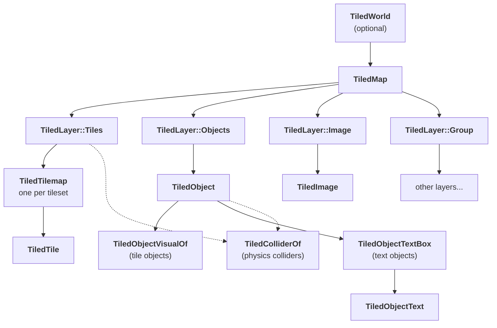

# Entities Hierarchy and Marker Components

When a map is loaded, it spawns **many** entities: for the map, for layers, for tiles, for objects, for colliders, and more.  
To keep things organized, these entities are structured in a [parent/child hierarchy](https://bevy-cheatbook.github.io/fundamentals/hierarchy.html), and every entity has an associated marker component to help with queries and system targeting.

Using a hierarchy also enables inheritance of certain components from top-level entities down the tree.  
For example, if you change the [`Visibility`](https://docs.rs/bevy/latest/bevy/render/view/visibility/enum.Visibility.html) of a layer entity, it will automatically apply to all entities below it in the hierarchy, such as tiles or objects.

---

## Hierarchy Overview



Dashed arrows are only present when the physics feature is enabled and the corresponding layer or object is selected to produce colliders.

Whatever their level in the hierarchy, entities spawned by `bevy_ecs_tiled` share a few common components:

- [`TiledMapReference`](https://docs.rs/bevy_ecs_tiled/latest/bevy_ecs_tiled/tiled/map/struct.TiledMapReference.html): the map entity they belong to, so you do not have to walk up the hierarchy to find it.
- [`TiledName`](https://docs.rs/bevy_ecs_tiled/latest/bevy_ecs_tiled/tiled/filter/struct.TiledName.html): the name given in Tiled to the layer, tileset or object.
- A Tiled identifier, such as [`TiledLayerId`](https://docs.rs/bevy_ecs_tiled/latest/bevy_ecs_tiled/tiled/layer/struct.TiledLayerId.html) or [`TiledObjectId`](https://docs.rs/bevy_ecs_tiled/latest/bevy_ecs_tiled/tiled/object/struct.TiledObjectId.html), to retrieve the raw Tiled data.

---

## World

A world is the optional top of the tree.  
Loading a `.world` asset gives you a [`TiledWorld`](https://docs.rs/bevy_ecs_tiled/latest/bevy_ecs_tiled/tiled/world/struct.TiledWorld.html) entity, which holds a handle to the corresponding [`TiledWorldAsset`](https://docs.rs/bevy_ecs_tiled/latest/bevy_ecs_tiled/tiled/world/asset/struct.TiledWorldAsset.html).

Each map of the world is spawned as a child of this entity.  
All map-level settings can be added to the world entity: they are propagated down to every underlying map.

## Map

Loading a `.tmx` asset gives you a [`TiledMap`](https://docs.rs/bevy_ecs_tiled/latest/bevy_ecs_tiled/tiled/map/struct.TiledMap.html) entity, which holds a handle to the corresponding [`TiledMapAsset`](https://docs.rs/bevy_ecs_tiled/latest/bevy_ecs_tiled/tiled/map/asset/struct.TiledMapAsset.html).  
It is the top of the tree, unless the map belongs to a world.

This is where you put map-level settings, such as the [`TilemapAnchor`](https://docs.rs/bevy_ecs_tilemap/latest/bevy_ecs_tilemap/anchor/enum.TilemapAnchor.html) or the [`TiledMapLayerZOffset`](https://docs.rs/bevy_ecs_tiled/latest/bevy_ecs_tiled/tiled/map/struct.TiledMapLayerZOffset.html).  
It also holds a [`TiledMapStorage`](https://docs.rs/bevy_ecs_tiled/latest/bevy_ecs_tiled/tiled/map/storage/struct.TiledMapStorage.html) component, which maps Tiled IDs to the spawned entities and the other way around.

## Layers

Each Tiled layer is spawned as a child of the map, with a [`TiledLayer`](https://docs.rs/bevy_ecs_tiled/latest/bevy_ecs_tiled/tiled/layer/enum.TiledLayer.html) component.  
Its value tells you the kind of layer, and what you will find below it:

| Variant | Children |
| --- | --- |
| [`TiledLayer::Tiles`](https://docs.rs/bevy_ecs_tiled/latest/bevy_ecs_tiled/tiled/layer/enum.TiledLayer.html#variant.Tiles) | one [`TiledTilemap`](https://docs.rs/bevy_ecs_tiled/latest/bevy_ecs_tiled/tiled/tile/struct.TiledTilemap.html) per tileset |
| [`TiledLayer::Objects`](https://docs.rs/bevy_ecs_tiled/latest/bevy_ecs_tiled/tiled/layer/enum.TiledLayer.html#variant.Objects) | one [`TiledObject`](https://docs.rs/bevy_ecs_tiled/latest/bevy_ecs_tiled/tiled/object/enum.TiledObject.html) per object |
| [`TiledLayer::Image`](https://docs.rs/bevy_ecs_tiled/latest/bevy_ecs_tiled/tiled/layer/enum.TiledLayer.html#variant.Image) | a single [`TiledImage`](https://docs.rs/bevy_ecs_tiled/latest/bevy_ecs_tiled/tiled/image/struct.TiledImage.html) |
| [`TiledLayer::Group`](https://docs.rs/bevy_ecs_tiled/latest/bevy_ecs_tiled/tiled/layer/enum.TiledLayer.html#variant.Group) | other layers, nested as in Tiled |

## Tiles

Tiles are stored in two levels:

- Below each `TiledLayer::Tiles`, there is one [`TiledTilemap`](https://docs.rs/bevy_ecs_tiled/latest/bevy_ecs_tiled/tiled/tile/struct.TiledTilemap.html) entity per tileset used by the layer.
  It holds the `TilemapBundle` from `bevy_ecs_tilemap`, so this is where the tilemap size, grid size or texture live.
- Below these tilemaps are the actual [`TiledTile`](https://docs.rs/bevy_ecs_tiled/latest/bevy_ecs_tiled/tiled/tile/struct.TiledTile.html) entities, one for each tile of the layer using this tileset.
  They are identified in Tiled by their [`TiledTilesetId`](https://docs.rs/bevy_ecs_tiled/latest/bevy_ecs_tiled/tiled/tile/struct.TiledTilesetId.html) and [`TiledTileId`](https://docs.rs/bevy_ecs_tiled/latest/bevy_ecs_tiled/tiled/tile/struct.TiledTileId.html), and positioned with a `TilePos`.

## Objects

Each Tiled object is spawned as a child of its `TiledLayer::Objects`, with a [`TiledObject`](https://docs.rs/bevy_ecs_tiled/latest/bevy_ecs_tiled/tiled/object/enum.TiledObject.html) component describing its shape (point, rectangle, polygon, ...).  
Most objects are a single entity, but two kinds of objects have children holding their visual.

### Tile objects

A [`TiledObject::Tile`](https://docs.rs/bevy_ecs_tiled/latest/bevy_ecs_tiled/tiled/object/enum.TiledObject.html#variant.Tile) has a child entity with a [`TiledObjectVisualOf`](https://docs.rs/bevy_ecs_tiled/latest/bevy_ecs_tiled/tiled/object/struct.TiledObjectVisualOf.html) component.  
This child holds the `Sprite` of the tile and, if the tile is animated, a [`TiledAnimation`](https://docs.rs/bevy_ecs_tiled/latest/bevy_ecs_tiled/tiled/animation/struct.TiledAnimation.html).  
From the object entity, you can reach it through the [`TiledObjectVisuals`](https://docs.rs/bevy_ecs_tiled/latest/bevy_ecs_tiled/tiled/object/struct.TiledObjectVisuals.html) relationship.

### Text objects

A [`TiledObject::Text`](https://docs.rs/bevy_ecs_tiled/latest/bevy_ecs_tiled/tiled/object/enum.TiledObject.html#variant.Text) is rendered using two nested entities, if the `text` feature is enabled (it is by default):

- a [`TiledObjectTextBox`](https://docs.rs/bevy_ecs_tiled/latest/bevy_ecs_tiled/tiled/object/struct.TiledObjectTextBox.html) child, which represents the text box drawn in Tiled: its `Aabb` has the size of the box.
- below it, a [`TiledObjectText`](https://docs.rs/bevy_ecs_tiled/latest/bevy_ecs_tiled/tiled/object/struct.TiledObjectText.html) entity holding the actual `Text2d` and `TextFont`.
  Its `Anchor` and position inside the box follow the horizontal and vertical alignment set in Tiled.

To change the text content or style at runtime, query the `TiledObjectText` entity:

```rust,no_run
use bevy::prelude::*;
use bevy_ecs_tiled::prelude::*;

fn make_texts_red(mut texts: Query<&mut TextColor, Added<TiledObjectText>>) {
    for mut color in texts.iter_mut() {
        color.0 = Color::srgb(1., 0., 0.);
    }
}
```

See the [`map_text` example](https://github.com/adrien-bon/bevy_ecs_tiled/blob/main/examples/map_text.rs) for a demo.

## Images

An image layer has a single [`TiledImage`](https://docs.rs/bevy_ecs_tiled/latest/bevy_ecs_tiled/tiled/image/struct.TiledImage.html) child, holding the `Sprite` of the image.  
When the image is repeated along an axis, the sprite size is updated to cover what the camera can see.

## Physics Colliders

At the bottom of the hierarchy, you find physics colliders.  
They are spawned as children of their source, either a `TiledLayer::Tiles` or a `TiledObject`, and carry:

- a [`TiledColliderOf`](https://docs.rs/bevy_ecs_tiled/latest/bevy_ecs_tiled/physics/collider/struct.TiledColliderOf.html) relationship pointing to their source entity.
  On the other side, the source has a [`TiledColliders`](https://docs.rs/bevy_ecs_tiled/latest/bevy_ecs_tiled/physics/collider/struct.TiledColliders.html) component listing all its colliders.
- a [`TiledColliderSource`](https://docs.rs/bevy_ecs_tiled/latest/bevy_ecs_tiled/physics/collider/enum.TiledColliderSource.html) component telling whether the collider comes from a tiles layer or from an object.

See the [physics guide](../guides/physics.md) for more information.

---

## Transform and Visibility Propagation

Bevy automatically propagates [`Transform`](https://docs.rs/bevy/latest/bevy/transform/components/struct.Transform.html) and [`Visibility`](https://docs.rs/bevy/latest/bevy/render/view/visibility/enum.Visibility.html) components down the entity hierarchy.

**In practice:**  
If you change one of these components for a top-level entity (e.g., a layer), it will propagate down and apply to all child entities. For example:

- Adding `Visibility::Hidden` to an object layer will hide all objects in that layer.
- Moving an object layer will also move all objects it contains.

**Special case for tiles:**  
Tiles are not rendered as individual entities, but as part of a "chunk" of several tiles for performance reasons.  
Each individual tile entity does **not** have its own [`Transform`](https://docs.rs/bevy/latest/bevy/transform/components/struct.Transform.html) or [`Visibility`](https://docs.rs/bevy/latest/bevy/render/view/visibility/enum.Visibility.html) component.  
Instead, these components are propagated down to the [`TiledTilemap`](https://docs.rs/bevy_ecs_tiled/latest/bevy_ecs_tiled/tiled/tile/struct.TiledTilemap.html), and `bevy_ecs_tilemap` handles updating the corresponding tile chunks.

> **Important:**  
> Even though you technically could, you should **not** add [`Transform`](https://docs.rs/bevy/latest/bevy/transform/components/struct.Transform.html) or [`Visibility`](https://docs.rs/bevy/latest/bevy/render/view/visibility/enum.Visibility.html) components to individual tile entities:
>
> - It will not have the intended effect—everything is handled at the tilemap level.
> - It may hurt performance significantly.
